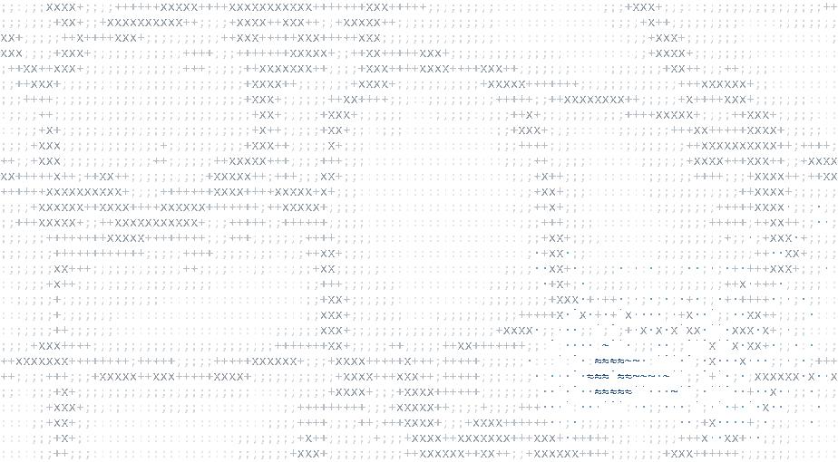

# ascii-pond

<picture>
  <source media="(prefers-color-scheme: dark)" srcset="docs/pond-dark.gif">
  
</picture>

Shown with `ripples: true`. The web of light under the ripples is the xiao.sh water texture, which this package does not draw.

Originally from [xiao.sh](https://x.com/inperspicuous/status/2077676490234224845).

ASCII water on a canvas. The pointer splashes the surface, and waves spread and fade.
The waves are hidden by default; pass `ripples: true` to draw them.
The pond also steers anything that swims in it away from the pointer.
No framework and no dependencies.

The koi that swim in it are a separate package: [ascii-koi](https://github.com/i098/ascii-koi).

## Install

```sh
npm install ascii-pond
```

The same version is on GitHub Packages as `@i098/ascii-pond` (add `@i098:registry=https://npm.pkg.github.com` to `.npmrc`).

## Usage

```ts
import { mountPond } from "ascii-pond";

const pond = mountPond(document.getElementById("hero")!, { fontSize: 14 });
// later
pond.destroy();
```

`mountPond(target, options)` takes a `<canvas>` or any element. For an element, it adds a canvas that fills the element.

- The grid follows the size of the box (`ResizeObserver`).
- Pointer moves and clicks splash the water, and the pond steers swimmers away from the pointer.
- Drawing stops while the canvas is off-screen or the tab is hidden.
- With `prefers-reduced-motion: reduce`, it draws one still frame and ignores the pointer.

| Option | Default | Effect |
| --- | --- | --- |
| `fontSize` | `14` | Glyph size in CSS px |
| `lineHeight` | `1.2` | Row height as a multiple of `fontSize` |
| `fontFamily` | system monospace | Font for the glyphs |
| `background` | `"#030c0d"` | Canvas fill; `"transparent"` clears instead |
| `interactive` | `true` | Pointer splashes and steering |
| `ripples` | `false` | Draw the waves |
| `reducedMotion` | the user setting | Draw one still frame |
| `scene` | plain water | `(cols, rows) => Scene`: draw your own layer over the water |

### The engine without the canvas

`Pond` is the simulation alone (typed arrays, no DOM), for terminals or your own renderer:

```ts
import { Pond, waterBucket } from "ascii-pond";

const pond = new Pond(80, 24);
pond.splash(40, 12, 6);
pond.step(16); // ms since the last frame
const height = pond.field[12 * pond.W + 40];

// steer a swimmer: push where it heads next away from the pointer
pond.mouse = { x: 40, y: 12 }; // pointer cell
const next = { x: 44, y: 26 }; // x in cells, y in half-cells (2 per row)
if (pond.steer(next, 42, 25)) {
  // the pointer startled it; `next` now points away
}
```

## Demo

```sh
npm install && npm run build
python3 -m http.server   # then open http://localhost:8000/demo/
```

## License

Apache-2.0
