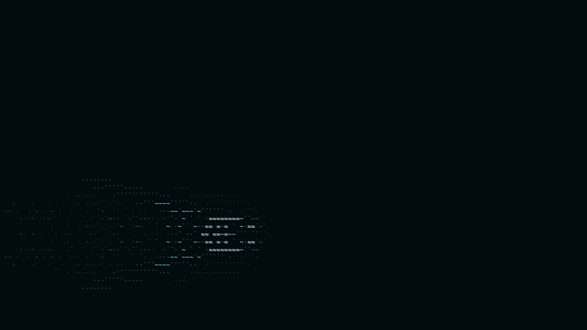

# ascii-pond

```
        ··         ··
      ·˙·  ···˙···  ·˙·
     ·˙˙˙˙˙~·~·~·~˙˙˙˙˙·
    ·˙·~~·˙ ····· ˙·~~˙˙˙····· ······
    ·· ˙· ˙ ~·~·~ ˙ ·˙ ~~  ·˙˙˙˙˙·  ˙˙·
    ·˙·~~·˙ ····· ˙·~˙~~˙~˙~˙~˙~˙~˙~~˙~·
     ·˙˙˙˙˙~·~·~·~˙˙·~~~≈˙˙ ·˙˙˙· ˙˙≈~˙~˙···     ····
      ·˙·  ···˙···  ˙~ ˙··~ ~·~·~ ~··˙ ~˙  ···˙···  ·˙·
        ····     ···˙~˙~≈˙˙ ·˙˙˙· ˙˙≈~~~·˙˙~·~·~·~˙˙˙˙˙·
                     ·~˙~~˙~˙~˙~˙~˙~˙~~˙~·˙ ····· ˙·~~·˙·
                      ·˙˙  ·˙˙˙˙˙·  ~~ ˙· ˙ ~·~·~ ˙ ·˙ ··
                        ······ ·····˙˙˙~~·˙ ····· ˙·~~·˙·
                                     ·˙˙˙˙˙~˙~˙~˙~˙˙˙˙˙·
                                      ·˙·  ·˙˙˙˙˙·  ·˙·
```



ASCII water on a canvas. Waves spread, ripples fade, and the pointer splashes the surface.
No framework and no dependencies.

The koi that swim in it are a separate package: [ascii-koi](https://github.com/i098/ascii-koi).

## Install

```sh
npm install ascii-pond
```

## Usage

```ts
import { mountPond } from "ascii-pond";

const pond = mountPond(document.getElementById("hero")!, { fontSize: 14 });
// later
pond.destroy();
```

`mountPond(target, options)` takes a `<canvas>` or any element. For an element, it adds a canvas that fills the element.

- The grid follows the size of the box (`ResizeObserver`).
- Pointer moves and clicks make ripples.
- Drawing stops while the canvas is off-screen or the tab is hidden.
- With `prefers-reduced-motion: reduce`, it draws one still frame and ignores the pointer.

| Option | Default | Effect |
| --- | --- | --- |
| `fontSize` | `14` | Glyph size in CSS px |
| `lineHeight` | `1.2` | Row height as a multiple of `fontSize` |
| `fontFamily` | system monospace | Font for the glyphs |
| `background` | `"#030c0d"` | Canvas fill; `"transparent"` clears instead |
| `interactive` | `true` | Pointer ripples |
| `reducedMotion` | the user setting | Draw one still frame |
| `scene` | plain water | `(cols, rows) => Scene`: draw your own layer over the water |

### The engine without the canvas

`Pond` is the simulation alone (typed arrays, no DOM), for terminals or your own renderer:

```ts
import { Pond, waterBucket } from "ascii-pond";

const pond = new Pond(80, 24);
pond.splash(40, 12, 6);
pond.step(16); // ms since the last frame
const height = pond.field[12 * pond.W + 40];
```

## Demo

```sh
npm install && npm run build
python3 -m http.server   # then open http://localhost:8000/demo/
```

## License

Apache-2.0
